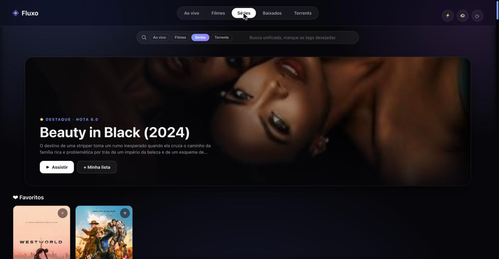
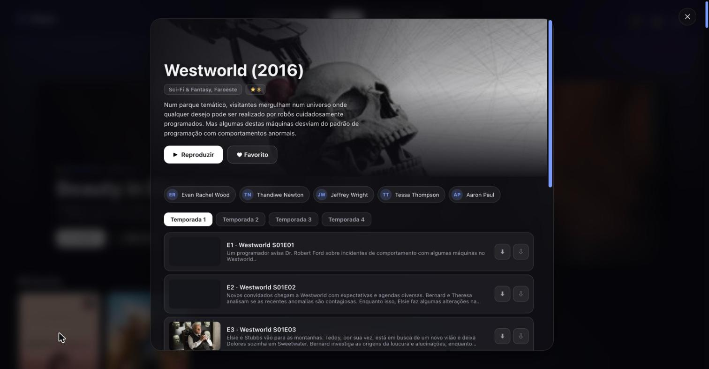
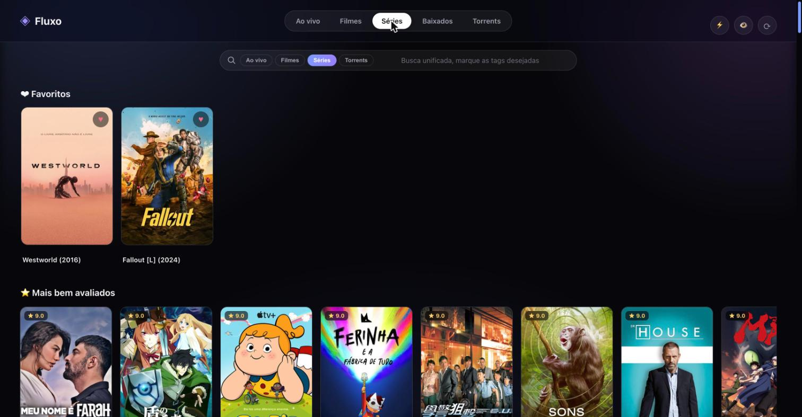

<p align="center">
  
</p>

<p align="center">
  
  
  
  
</p>

<p align="center">
  <b>Fluxo</b> é um player de IPTV que roda no navegador de qualquer aparelho — sem instalar app, sem assinatura, sem travar.<br>
  Aponta pro seu provedor <a href="#-provedor">Xtream Codes</a> e pronto: TV ao vivo, filmes, séries, download pra ver offline e busca por torrents, tudo numa interface só.
</p>

<p align="center">
  
</p>

---

## ✨ O que ele faz

- **📺 Ao vivo, Filmes e Séries** organizados por categoria, com capas, elenco, sinopse e nota.
- **🔎 Busca unificada** — procura em tudo (ao vivo, filmes, séries e torrents) marcando as tags que quiser.
- **▶️ Toca liso até em TV/PC fraco** — ao vivo via **HLS nativo** (decodifica em hardware no Safari/Mac antigo) e, pros canais `[H265]`, **transcode H265→H264 sob demanda** via ffmpeg.
- **⚡ Modo leve** — um clique desliga blur/animações pra rodar redondo em hardware limpo.
- **⬇️ Baixar pra ver depois** — no **servidor** (fica guardado, toca offline) ou **no aparelho**. Filmes grandes caem em ~1 min.
- **🧲 Torrents integrados** (opcional) — busca via [Jackett](https://github.com/Jackett/Jackett) e baixa pelo transmission, direto da interface.
- **❤️ Favoritos, histórico e "continuar assistindo"** que **sincronizam entre os aparelhos** (ficam no servidor, não só no navegador).
- **⏭️ Próximo episódio automático**, **retomar de onde parou** e **reconexão** se a internet oscilar.
- **📶 Guia de programação (EPG)** com o que está passando agora e a seguir.
- **🗂️ Aba "Baixados"** — tudo que você baixou (ou jogou na pasta via rede) toca offline aqui.

## 📸 Capturas

| Detalhe da série | Catálogo |
|---|---|
|  |  |

## 🧩 Como funciona

```
Navegador  ──►  Fluxo (server.js, Node puro)  ──►  Provedor Xtream Codes
                     │
                     ├─ esconde suas credenciais (ficam só no config.json)
                     ├─ resolve CORS (serve tudo na mesma origem)
                     ├─ faz proxy + cache das imagens (capas leves e rápidas)
                     ├─ transcode H265→H264 sob demanda (ffmpeg)
                     └─ (opcional) Jackett + transmission pros torrents
```

- **Backend:** um único `server.js` em **Node.js puro, zero dependências**. É um proxy que fala a API `player_api.php` do Xtream Codes, repassa os streams (seguindo os redirects pro CDN), serve as imagens em cache e esconde sua credencial.
- **Frontend:** HTML/CSS/JS **sem build e sem framework**. Usa [hls.js](https://github.com/video-dev/hls.js) e [mpegts.js](https://github.com/xqq/mpegts.js) via CDN só pro vídeo.

## 🚀 Instalação

### Requisitos
- **Node.js 18+**
- Uma conta num provedor **Xtream Codes** (o painel que dá `usuário`, `senha` e um `host`).
- **ffmpeg** no PATH — opcional, só pra transcode de canais H265.

### Passos

```bash
git clone https://github.com/SEU_USUARIO/fluxo.git
cd fluxo

# cria seu config a partir do exemplo e preenche os dados do provedor
cp config.example.json config.json
nano config.json

# sobe
node server.js
```

Abra **http://localhost:8085** (ou o IP da máquina na sua rede).

### Rodar como serviço (systemd)

```ini
# /etc/systemd/system/fluxo.service
[Unit]
Description=Fluxo IPTV
After=network.target

[Service]
WorkingDirectory=/opt/fluxo
ExecStart=/usr/bin/node /opt/fluxo/server.js
Restart=always

[Install]
WantedBy=multi-user.target
```

```bash
sudo systemctl enable --now fluxo
```

## ⚙️ Configuração

Copie `config.example.json` para `config.json` e preencha:

| Campo | O que é |
|---|---|
| `port` | Porta do Fluxo (padrão `8085`). |
| `provider.host` | Host do seu provedor Xtream (ex.: `meuprovedor.com`). |
| `provider.username` / `password` | Suas credenciais do painel. |
| `userAgent` | User-Agent enviado ao provedor (deixe o padrão se não souber). |
| `jackett` *(opcional)* | `url` e `apikey` do seu [Jackett](https://github.com/Jackett/Jackett), pra aba de torrents. |
| `transmission` *(opcional)* | `host`/`port` do RPC do transmission, pra baixar os torrents. |
| `torrentDir` *(opcional)* | Pasta onde os torrents são salvos. |

> **O `config.json` tem suas credenciais e está no `.gitignore`.** Nunca faça commit dele.

### <a name="-provedor"></a>Sobre o provedor
O Fluxo **não** fornece conteúdo nem credenciais — você usa o **seu** acesso a um provedor Xtream Codes. A parte de torrents também é opcional e depende de você configurar Jackett + transmission.

## 🗺️ Roadmap
- [ ] Perfis / múltiplos provedores
- [ ] Logo próprio dentro do app + favicon
- [ ] Legendas externas (quando o arquivo não tem faixa embutida)
- [ ] Empacotar instalação (script único)

## 🤝 Contribuindo
Issues e PRs são bem-vindos! Este é um projeto de homelab feito pra ser simples de entender e mexer.

## 📜 Licença
[GPLv3](LICENSE) — você pode usar, estudar, modificar e distribuir. Se distribuir uma versão modificada, ela também precisa ser aberta sob a GPL.
